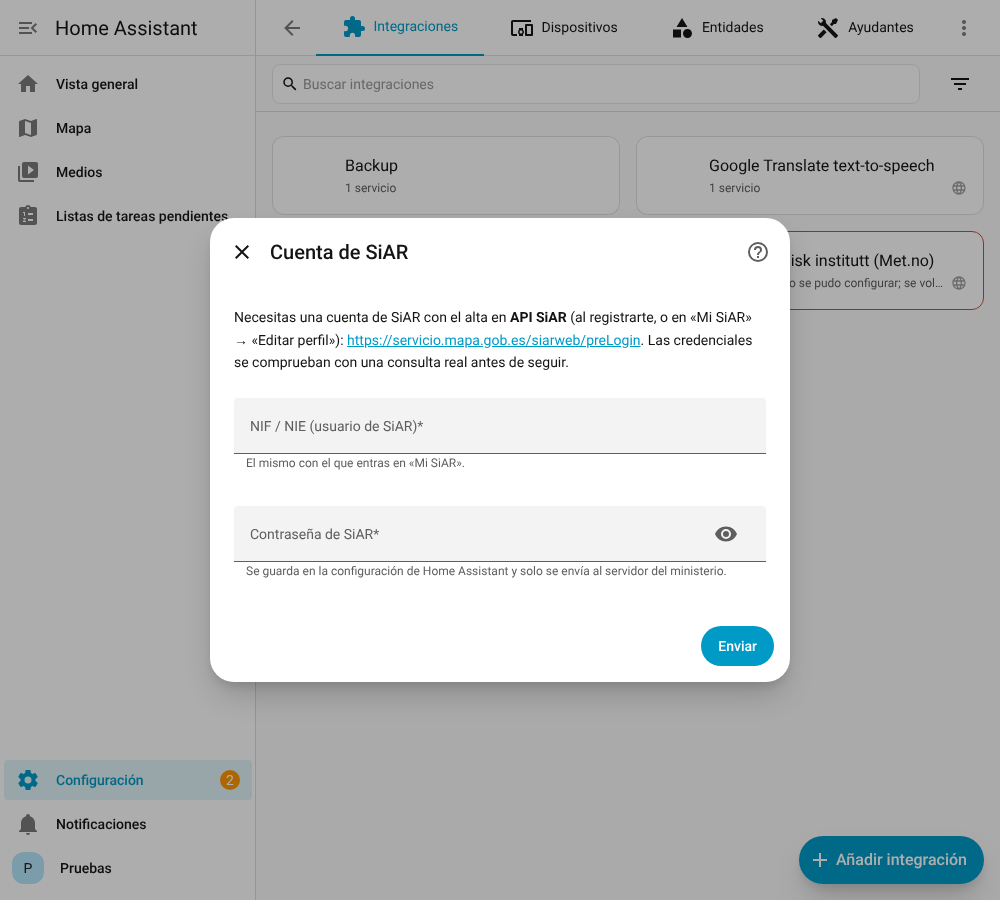
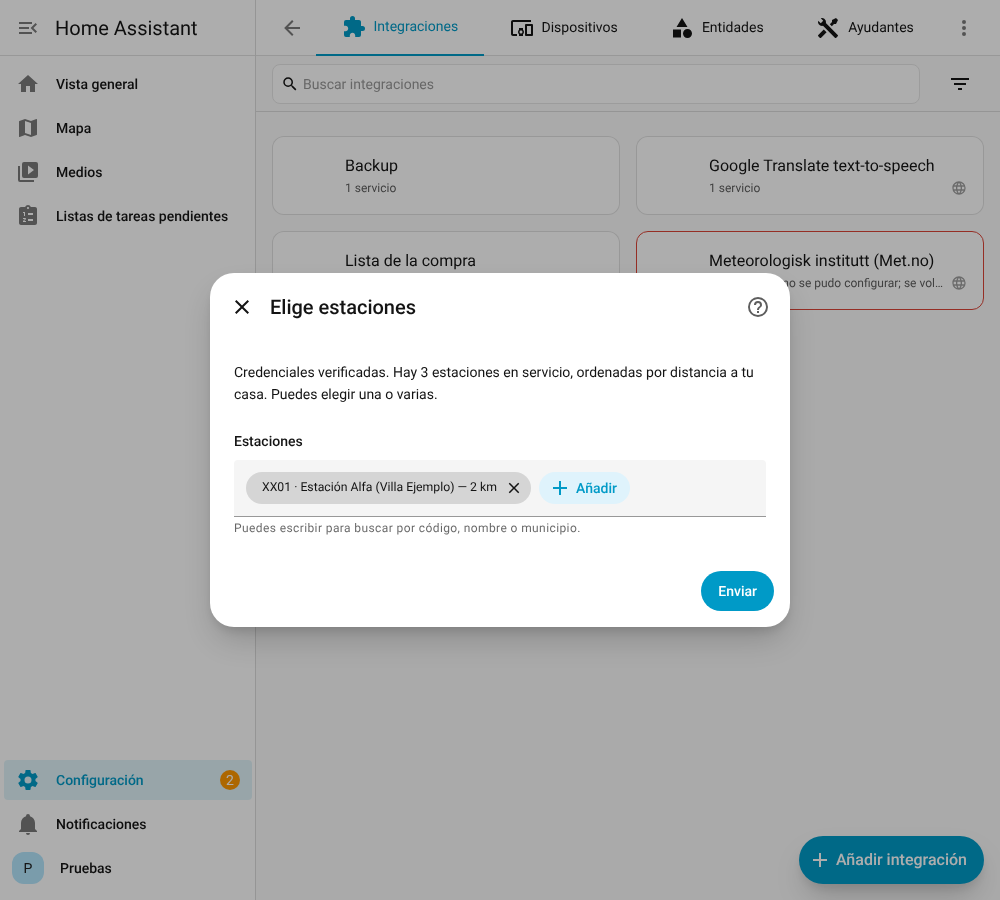
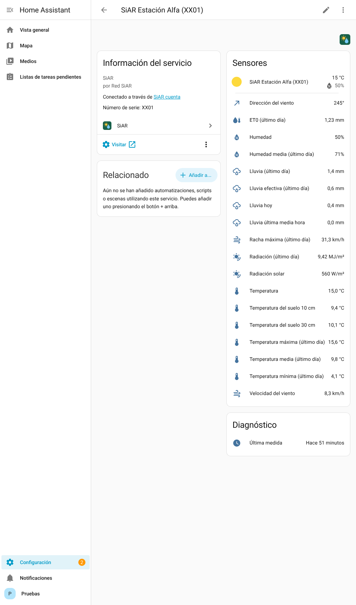

# SiAR para Home Assistant

Integración que lleva a Home Assistant los datos de las estaciones agroclimáticas de la
[red SiAR](https://servicio.mapa.gob.es/siarweb/) (Ministerio de Agricultura, Pesca y Alimentación),
como una integración del tiempo: eliges **una o varias estaciones** y cada una aparece como un
dispositivo con su entidad del tiempo y sus sensores, incluida la evapotranspiración (ET0) para el riego.

Proyecto personal, sin relación con el Ministerio.

> **Estado:** primera versión (0.1.0). Probada con un servicio SiAR simulado a partir del manual oficial
> de la API v2.2; falta confirmarla con una cuenta real.

## Requisitos

- Home Assistant **2026.11.0** o posterior.
- Una cuenta de SiAR con el alta en **API SiAR**: marca «Deseo darme de alta en API SiAR» al
  registrarte, o actívalo después en «Mi SiAR» → «Editar perfil».

## Instalación

1. En la tienda de Home Assistant (Marketplace / HACS), añade `https://github.com/manu8613/siar-ha`
   como repositorio personalizado de tipo **Integración** e instala **SiAR**.
   A mano: copia `custom_components/siar` a la carpeta `custom_components` de tu configuración.
2. Reinicia Home Assistant.
3. Ajustes → Dispositivos y servicios → Añadir integración → **SiAR**.

## Configuración

| 1. Cuenta | 2. Estaciones |
|---|---|
|  |  |

**Las credenciales se comprueban de verdad.** El servicio de SiAR devuelve algo con aspecto de token
incluso con una contraseña equivocada, así que la integración solo las da por buenas cuando una
consulta protegida (los límites de tu cuenta) funciona. Después lee la lista de estaciones y comprueba
que las elegidas tienen datos recientes (si alguna no los tiene te avisa; si envías otra vez, se añade).

Las estaciones salen ordenadas por distancia a la ubicación de tu Home Assistant.
Con el botón **Configurar** puedes añadir o quitar estaciones y cambiar cada cuánto se consulta
(60 min por defecto, mínimo 30). Si SiAR deja de aceptar la contraseña, Home Assistant te la pide de nuevo.

## Qué crea



Por cada estación:

| Entidad | Origen |
|---|---|
| Tiempo (`weather`) | Última media hora: temperatura, humedad y viento |
| Temperatura, humedad, viento (velocidad y dirección), radiación solar, lluvia | Última media hora |
| Temperatura del suelo a 10 y 30 cm | Solo si la estación tiene esas sondas |
| Lluvia hoy | Suma desde las 00:00 locales |
| ET0 (Penman-Monteith), lluvia efectiva, lluvia, temperaturas máxima, media y mínima, humedad media, racha máxima, radiación | Último día completo publicado (atributo `fecha`) |
| Última medida (diagnóstico) | Hora del dato más reciente |

Además, el dispositivo «SiAR cuenta» tiene el número de peticiones hechas hoy y, como atributos, los límites.

Cosas que conviene saber:

- SiAR publica medias de 30 minutos y con retraso: mira «Última medida». Con datos de más de 48 horas
  las entidades de tiempo actual quedan como no disponibles.
- **No hay previsión**: SiAR solo da observaciones.
- **El estado del cielo es una estimación**, porque las estaciones no miden nubes: lluvia por el
  pluviómetro, ventoso a partir de 10,8 m/s y, con el sol a más de 10°, la radiación medida frente a la de
  un cielo despejado. De noche, sin lluvia ni viento, el estado es desconocido.

## Consumo de la cuenta

Con hasta 10 estaciones y consulta cada 60 minutos son unas 60 peticiones al día (el doble cada 30),
más las de volver a identificarse cuando caduca el token. Cada cuenta tiene un límite diario y por
minuto; puedes verlo en el sensor «Peticiones de hoy».

## Seguridad

- La API oficial envía NIF, contraseña y token **en la dirección de la petición** (cifrada en tránsito
  por HTTPS, pero así lo diseñó el servicio). La integración no escribe nunca esas direcciones en el
  registro, no sigue redirecciones y oculta las credenciales en los mensajes de error y diagnósticos.
- Home Assistant guarda las credenciales **sin cifrar** en su configuración (`.storage`), igual que las de
  otras integraciones: usa una contraseña exclusiva para SiAR y protege las copias de seguridad.

## Datos

Fuente: SiAR, Ministerio de Agricultura, Pesca y Alimentación. Se pueden reutilizar citando la fuente
y sin garantías; consulta el [aviso legal](https://servicio.mapa.gob.es/siarweb/avisoLegal).

## Desarrollo

```bash
pip install -r requirements_test.txt
ruff check . && pytest -q
```

Licencia MIT · creado por [manu8613](https://github.com/manu8613)
